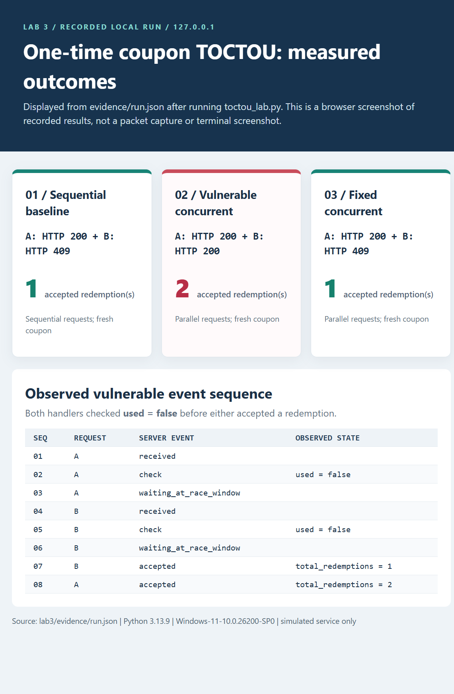
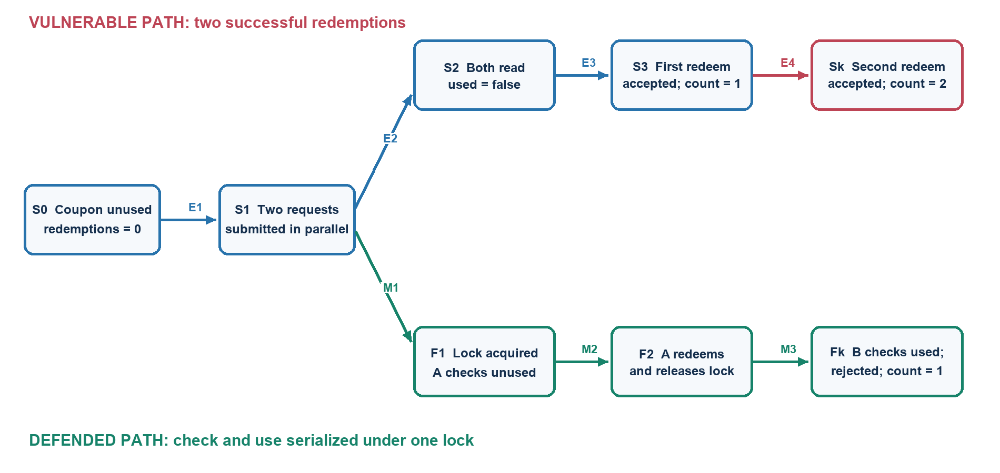

# HANGZHOU DIANZI UNIVERSITY

**Information Security | Laboratory Work No. 3**

## TOCTOU Race Condition in a One-Time Coupon

*Attacker digraph, sequence of actions, losses and countermeasures*

| Field | Value |
| --- | --- |
| Surname and name | **[Student to fill in]** |
| HDU number | **[Student to fill in]** |
| Date | 8 November 2026 |
| Experiment | Locally simulated coupon redemption; no external target |

The supplied DNS cache poisoning report was used as an organizational example
only. The attack topic, local software, measured results, graph and analysis
below concern a different experiment.

## 1. Purpose of the work

The objective is to describe a concrete computer attack as a directed graph
whose vertices are observable system states and whose edges are attacker
actions or system transitions. The selected attack is a **time-of-check to
time-of-use (TOCTOU) race condition** in a one-time coupon workflow. A correct
service must maintain the invariant
`successful_redemptions <= 1` for a fresh coupon.

This report tests three cases against a local HTTP service: two requests in
sequence, two concurrent requests against a deliberately vulnerable handler,
and two concurrent requests against a fixed handler. It records responses and
the server-side order of events, explains the resulting losses, and relates
defensive controls to specific edges in the graph.

## 2. Theoretical background

### 2.1. TOCTOU and shared state

MITRE [CWE-367][cwe] describes a check of a resource's state before its use
when that state may change between the two operations. Here the resource is a
coupon with a shared `used` flag. A vulnerable handler first checks whether it
is unused and later records a redemption. If two handlers check the same
coupon before either records the change, both may act on an outdated result.
PortSwigger uses one-time promotional codes as an example of this "limit
overrun" race condition [2].

Conceptually, the vulnerable and protected operations differ as follows:

```text
Vulnerable:
  if not coupon.used:
      record_redemption()
      coupon.used = true

Protected:
  lock:
      if not coupon.used:
          record_redemption()
          coupon.used = true
```

In the vulnerable case, making the **write** thread-safe without also
protecting the **check** does not preserve the one-redemption invariant. A
sequential test is also insufficient: request B only checks the coupon after
request A has finished, so it correctly rejects B even when the underlying
implementation is vulnerable to overlap.

### 2.2. Laboratory assumptions and boundaries

The attacker controls two requests for the same coupon and can send them
concurrently. The [experiment program](toctou_lab.py) runs a
`ThreadingHTTPServer` bound only to `127.0.0.1` with a new in-memory coupon
for every case. The header `X-Demo-User: alice` is only a demo label, **not**
an authentication mechanism. Ports are selected by the operating system.

For reproducibility, the vulnerable concurrent handler uses a two-party
barrier **after** each request checks the coupon. The barrier deliberately
widens the race window and forces the interleaving. This proves that the
non-atomic implementation permits the forbidden outcome; it is **not** a
measurement of the likelihood of exploitation on a real service.

## 3. Attacker's sequence of actions and experimental process

### 3.1. Prerequisites and preparation

An attacker in this model has a one-use coupon and can submit two requests to
its redemption endpoint. They need no administrative access or IP spoofing.
The experiment requires only Python 3.10+ and a local machine; it does not
send traffic to a third-party system. The test platform recorded in
[`run.json`](evidence/run.json) was Windows 11 with Python 3.13.9.

The following command actually ran the full experiment:

```powershell
python .\toctou_lab.py --output .\evidence\run.json
```

The real client sends `POST /redeem` with `X-Demo-User: alice` and distinct
`X-Request-ID` values `A` and `B`. Both attempts target the same fresh coupon
within a scenario; the three scenarios each start with a different fresh
coupon. The client and server record request fields, HTTP response
status/headers/body, ordered server events and final state in
[`evidence/run.json`](evidence/run.json). These are application-level records,
**not a network packet capture**.

### 3.2. Sequential baseline

Send A, wait for completion, and then send B. A receives HTTP 200 and the
JSON body `{"accepted":true,"total_redemptions":1}`. B receives HTTP 409
and `{"accepted":false,"total_redemptions":1}`. The event log shows A
checking `used=false`, followed by B checking `used=true`.

### 3.3. Concurrent attack

Launch A and B together. Each handler checks `used=false`; both wait at the
barrier; both continue and accept redemption. In the saved run, the relevant
event sequence was:

```text
02  A  check      used=false
05  B  check      used=false
07  B  accepted   total_redemptions=1
08  A  accepted   total_redemptions=2
```

Both HTTP responses were 200. The final server state reports
`successful_redemptions=2`, violating the one-use invariant. The order in
which A and B succeed may change on another run; two successful responses
and the final count of 2 are the important observations.

### 3.4. Fix and comparative verification

In fixed mode, an in-process `transaction_lock` encloses the **entire check
and update**. The first request acquires the lock, checks and redeems; the
second subsequently reads `used=true` and is rejected. The saved run
returned HTTP 200 for A, HTTP 409 for B, and
`successful_redemptions=1`. The three [automated regression
tests](test_toctou.py) also passed.

| Scenario | A / B HTTP status in saved run | Final accepted count | Invariant |
| --- | --- | ---: | --- |
| Vulnerable, sequential | 200 / 409 | 1 | Preserved |
| Vulnerable, parallel | **200 / 200** | **2** | **Broken** |
| Fixed, parallel | 200 / 409 | 1 | Preserved |



*Figure 1. Actual browser screenshot of a local evidence viewer reading
`evidence/run.json` after the code ran. This is a visual presentation of the
recorded results and event trace; it is not a terminal screenshot or packet
capture. The underlying JSON remains the authoritative record.*

## 4. Digraph of the attack

Let `G = (V, E)`. Blue edges in Figure 2 describe the vulnerable execution;
green edges show a *separate* execution with the protection enabled. `Sk` is
the attacker-success end state, and `Fk` is the defended end state.



*Figure 2. Directed graph of the local TOCTOU experiment. Edges denote
actions or transitions; vertices denote states.*

### 4.1. Description of the states

| State | Meaning and relevant system state |
| --- | --- |
| `S0` | Coupon unused; accepted count 0. |
| `S1` | A and B submitted concurrently against the same coupon. |
| `S2` | Both vulnerable handlers have observed `used=false`. |
| `S3` | First redemption accepted; coupon now marked used; count 1. |
| `Sk` | Second handler still acts on its stale check; count 2. |
| `F1` | Fixed handler A holds the lock and checks the unused coupon. |
| `F2` | A has redeemed once and released the lock; count 1. |
| `Fk` | B acquires the lock later, reads `used=true` and is rejected. |

### 4.2. Description of the edges

| Edge | Action or state transition |
| --- | --- |
| `E1: S0 -> S1` | Attacker submits two overlapping POST requests. |
| `E2: S1 -> S2` | Both vulnerable handlers check before either update. |
| `E3: S2 -> S3` | First handler records an accepted redemption. |
| `E4: S3 -> Sk` | Second acts on a stale check and also succeeds. |
| `M1: S1 -> F1` | Protected handler A acquires the lock before checking. |
| `M2: F1 -> F2` | A checks and redeems while holding the lock. |
| `M3: F2 -> Fk` | B sees the updated state and receives HTTP 409. |

The two `check used=false` events in [`run.json`](evidence/run.json) justify
`S2`; the two accepted events justify `S3` and `Sk`. The green path begins
from `S1` as a *different configuration*. It does not branch from `S2`
after two unsafe checks have already occurred.

## 5. Losses and possible countermeasures

### 5.1. Observed and potential losses

The **observed** loss is an integrity violation: one coupon was accepted
twice in the local vulnerable scenario. A production reward or purchase flow
*could* incur economic loss or unfair allocation if each successful
redemption grants value. This experiment did **not** involve money, real
accounts, confidentiality loss or denial of service; those outcomes cannot
be claimed from the evidence.

### 5.2. Countermeasures mapped to the digraph

| Level | Measure | Which transition it addresses |
| --- | --- | --- |
| Application demo | Guard check **and** update with one lock | Prevents `E2 -> E4` within a single process |
| Persistent storage | Atomic conditional update or transaction/row lock | Prevents separate workers from both changing `unused` to `used` |
| Database integrity | Unique constraint on redemption per coupon | Rejects duplicate award records even if requests race |
| Request processing | Idempotency keys for retries | Prevents repeated handling of one request; does **not** replace a per-coupon atomicity rule |
| Operations | Detect multiple successful awards for one coupon | Reveals an incident but does not prevent `E4` |

OWASP also recommends coordinating concurrent operations and enforcing
integrity at the correct layer [3]. A Python lock protects only threads in
one process; it is **not sufficient** when multiple workers or machines
share a database. A deployed implementation should enforce the invariant in
shared storage and validate the affected-row count or transaction outcome.

## 6. Answers to control questions

**Vulnerability versus exploit.** The vulnerability is the check/use gap
(CWE-367). The exploit is the deliberate overlap of requests that causes two
checks to pass before either use. The graph models one concrete exploit
chain through this weakness.

**Why include initial and final states?** `S0` defines the legitimate
starting invariant; `Sk` makes the observed damage measurable. `Fk`
separately states the protected outcome.

**Can the same attack have different digraphs?** Yes. Additional requests,
different scheduling or a database-backed workflow introduce more states
and transitions. Here the graph deliberately describes just two requests
on one coupon.

**Which loss categories apply?** Data integrity is directly affected.
Economic loss depends on the value granted by a real coupon. Theft of
information and denial of service were not observed.

**How does the model help design defenses?** The graph identifies `E4`
as the stale-check transition that violates the invariant. An atomic
check-and-use operation removes the path to `Sk`; database-enforced
atomicity provides the analogous control across processes.

## 7. Conclusion

The local experiment reproduced a TOCTOU race: the vulnerable handler
accepted two uses of a nominally one-time coupon under overlapping requests,
whereas the sequential baseline and protected handler accepted only one.
The state digraph connects each observed action to a system state and shows
where a shared, atomic check/update would break the attack chain. The
barrier-assisted laboratory case demonstrates possibility, not the
frequency of real-world attacks.

## Appendix A. Reproduction and evidence

From the repository root:

```powershell
python .\toctou_lab.py --output .\evidence\run.json
python -m unittest discover -s . -p "test_*.py" -v
```

All three tests passed on the recorded run (`Ran 3 tests ... OK`).
The executable source is [`toctou_lab.py`](toctou_lab.py); regression tests
are in [`test_toctou.py`](test_toctou.py); the full recorded request and
response data is [`evidence/run.json`](evidence/run.json). Image files are
[`evidence/run_screenshot.png`](evidence/run_screenshot.png) and
[`attack_digraph.png`](attack_digraph.png).

## Appendix B. References

1. MITRE, [CWE-367: Time-of-check Time-of-use (TOCTOU) Race Condition][cwe].
2. PortSwigger Web Security Academy, [Race conditions][portswigger].
3. OWASP Foundation, [Race Conditions][owasp].

Sources accessed 8 November 2026.

[cwe]: https://cwe.mitre.org/data/definitions/367.html
[portswigger]: https://portswigger.net/web-security/race-conditions
[owasp]: https://owasp.org/www-community/pages/vulnerabilities/race_conditions
